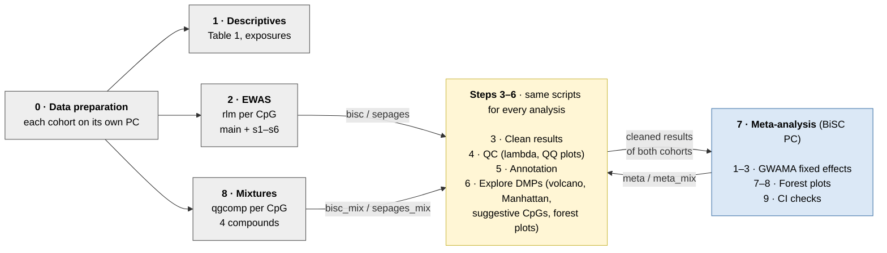
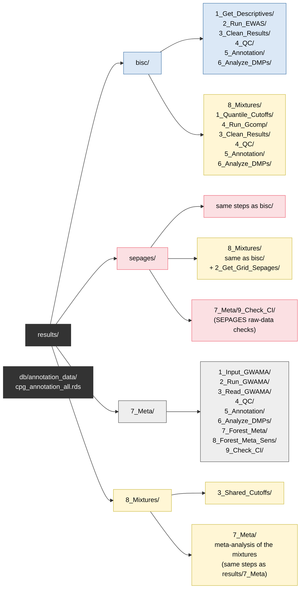

# Prenatal pesticide exposure and placental DNA methylation (BiSC + SEPAGES)

This repository holds the analysis code for an epigenome-wide association study (EWAS) of prenatal pesticide exposure and placental DNA methylation in two birth cohorts: **BiSC** (Barcelona) and **SEPAGES** (Grenoble).

**Author:** Joana Llauradó (ISGlobal), joana.llaurado@isglobal.org

## Contents

1. [Study design](#1-study-design)
2. [Project layout](#2-project-layout)
3. [Pipeline overview (Figure 1)](#3-pipeline-overview)
4. [How to run each step](#4-how-to-run-each-step)
5. [Results folders and files (Figure 2)](#5-results-folders-and-files)
6. [Conventions](#6-conventions)
7. [Requirements](#7-requirements)

---

## 1. Study design

| | |
|---|---|
| **Outcome** | Placental DNA methylation (Illumina EPIC), beta values |
| **Exposures** | Maternal urinary concentrations of 2,4-D (detected / not detected), 3-PBA, TCPy, ΣDMP, ΣDEP and ΣDAP (log2; the Σ exposures are molar sums of metabolites) |
| **Time points** | Second trimester (`t2`), third trimester (`t3`), pregnancy average (`avg` = mean of the log2 values at t2 and t3) |
| **Samples** | `2tp` = women with both time points (SEPAGES and BiSC); `tp` = all women with that time point (BiSC only) |
| **Single-exposure models** | Robust linear regression per CpG (`MASS::rlm`) |
| **Main covariates** | Maternal age, education, smoking, gestational age, child ethnicity, child sex, DNA contamination, 5 cell types (syncytiotrophoblast = reference); BiSC only: delivery hospital |
| **Sensitivity analyses** | `s1` excluding pregnancy complications · `s2` excluding non-European participants · `s3` + specific gravity · `s4` + fruit and vegetable intake · `s5` without gestational age and cell types · `s6` exposure outliers winsorized at P1/P99 |
| **Meta-analysis** | Fixed-effects inverse-variance meta-analysis of BiSC + SEPAGES with GWAMA |
| **Mixture models** | Quantile g-computation (`qgcomp.noboot`) per CpG of 3-PBA, TCPy, ΣDMP and ΣDEP, with cohort-specific or shared BiSC + SEPAGES quantile cut-offs |

The raw data of each cohort stay on that cohort's computer: the **BiSC PC** holds the BiSC data and runs the meta-analysis, the **SEPAGES PC** holds the SEPAGES data.

---

## 2. Project layout

The project has the same structure on both PCs. **Every script is run from the project root:**

```
<project>/
├── script/     ← this repository
├── db/         ← input data (only the cohort available on that PC)
└── results/    ← all outputs (same layout on both PCs)
```

All input and output paths are defined once, in `00_paths.R`, so the same code runs on both PCs without editing paths.

| File | Contents |
|---|---|
| `00_paths.R` | Locations of `db/` and `results/` for each cohort |
| `00_functions.R` | Shared functions (CpG filters, robust regression, QQ plots...); also loads `00_template_plot.R` |
| `00_template_plot.R` | Plot theme, colour palettes, `save_plot()`, `save_plots_pdf()`, `save_table()` |
| `BiSC/0_Get_Data/`, `Sepages/0_Get_Data/` | Cohort-specific data preparation (run on that cohort's PC) |
| `1_Get_Descriptives/` ... `8_Mixtures/` | Analysis steps, numbered in the order they are run |

### The `cohort` argument

Most scripts take the cohort as their **first argument**. It sets where results are read from and written to:

| Argument | Analysis | Results folder |
|---|---|---|
| `bisc`, `sepages` | Single-exposure EWAS of one cohort | `results/<cohort>/` |
| `meta` | Meta-analysis of the EWAS | `results/7_Meta/` |
| `bisc_mix`, `sepages_mix` | Mixture models of one cohort | `results/<cohort>/8_Mixtures/` |
| `meta_mix` | Meta-analysis of the mixture models | `results/8_Mixtures/7_Meta/` |

The same scripts in steps 3–6 (cleaning, QC, annotation, exploration of results) are used for all six.

---

## 3. Pipeline overview

**Figure 1.** Analysis steps. Steps 3–6 (yellow) are the same scripts for every analysis; the `cohort` argument on each arrow selects which results they work on. Grey steps run on both PCs (each on its own cohort); the meta-analysis (blue) runs on the BiSC PC.



---

## 4. How to run each step

All commands are run from the project root. Run dates (`YYYYMMDD`) and run-folder patterns are examples; replace them with your own. Run folders are named `<cohort>_<sample>_<tp>_<date>`, e.g. `bisc_tp_t2_20261022`.

### Step 0 · Data preparation (`BiSC/0_Get_Data`, `Sepages/0_Get_Data`)

Run on each cohort's own PC, in numeric order. These scripts build the analysis subsets in `db/subsets/` (and `db/subsets_2tp/` for BiSC), one per analysis (`df_main`, `df_s1` ... `df_s5`).

| Cohort | Scripts |
|---|---|
| BiSC | `1_1_Get_OP_Data_BiSC.R`, `1_1_Get_Pesticides_Data.R` → `1_2_Join_Pest_OP_Data.R` → `1_3_Compute_AVG_Pest.R` → `2_Get_DNAm_covars.R` → `3_Get_Covars.R` → `4_Join_All.R` → `5_Get_Final_Data.R` |
| SEPAGES | `0_Get_Data.R` → `1_Get_Final_Data.R` |

### Step 1 · Descriptives (`1_Get_Descriptives`)

```bash
Rscript script/1_Get_Descriptives/1_Get_Table0ne.R   sepages   # Table 1
Rscript script/1_Get_Descriptives/2_Get_Descr_Chem.R sepages   # exposure distributions, boxplots, correlations
```
`00_Plot_DAG.R` draws the directed acyclic graph (DAG) used to choose covariates.

### Step 2 · EWAS (`2_Run_EWAS`)

Arguments: `cohort`, `analysis` (`main`, `s1`...`s6`, `sens`, `all`), `time point`, `sample`, `run date`.

```bash
Rscript script/2_Run_EWAS/Run_EWAS.R sepages all t2 2tp 20261021
Rscript script/2_Run_EWAS/Run_EWAS.R bisc    all t3 tp  20261022

# All time points, in the background
nohup bash script/2_Run_EWAS/Run_All_Models.sh bisc tp > results/bisc/2_Run_EWAS/Run_All_Models.log 2>&1 &
```

### Step 3 · Clean results (`3_Clean_Results`)

Removes unreliable probes with the EPIC filter list (`exclude_CpGs()` in `00_functions.R`: general masking, SNP-affected and cross-hybridising probes, sex chromosomes) and adds Bonferroni and FDR p-values.

```bash
Rscript script/3_Clean_Results/1_Get_Files_To_Clean.R sepages "sepages_2tp_(t2|t3|avg)_20261021"   # list of files (editable)
Rscript script/3_Clean_Results/2_Clean_Results.R      sepages                                    # clean every listed file
Rscript script/3_Clean_Results/3_Get_Cleaned_Files.R  sepages                                    # index of cleaned files
```

### Step 4 · QC (`4_QC`)

```bash
Rscript script/4_QC/1_Get_QQplot.R   sepages "sepages_2tp_(t2|t3|avg)_20261021"   # lambda + QQ plot per file
Rscript script/4_QC/2_Join_QQplots.R sepages 2tp 20261021                         # multi-panel QQ figures
```

### Step 5 · Annotation (`5_Annotation`)

```bash
Rscript script/5_Annotation/1_Get_Annotation.R                                           # once: CpG annotation → db/annotation_data/
Rscript script/5_Annotation/2_Annotate_EWAS.R      sepages "sepages_2tp_(t2|t3|avg)_20261021"
Rscript script/5_Annotation/3_Get_Annotated_Files.R sepages                              # index of annotated files
```

### Step 6 · Explore results (`6_Analyze_DMPs`)

All scripts take `cohort` and a run-folder pattern. Run `1_` before `1b`/`1c`, `2_` before `2b`/`2c`, and `3a` before `3b`, `3c`, `4a`–`4c`.

| Script | Output |
|---|---|
| `1_Get_Volcano_Plot.R`, `1b_`, `1c_` | Volcano plot per model; panels by time point (`1c` with shared axes) |
| `2_Get_Manhattan_Plot.R`, `2b_`, `2c_` | Manhattan plot per model; panels by time point (`2c` with shared y-axis) |
| `3a_Get_Suggestive_Summary.R` | Tables 1–2: suggestive CpGs (p < 1e-5) and their look-up in s1–s6 |
| `3b_Get_Consistency_Summary.R` | Tables 3–4: t2 vs t3, CpGs shared across exposures |
| `3c_Get_Avg_Consistency_Summary.R` | Tables 5–6: pregnancy average vs trimesters |
| `3d_Get_Suggestive_Counts_Barplot.R` | Number of suggestive CpGs per exposure and direction |
| `4a_`, `4b_`, `4c_Get_Forest_*.R` | Forest plots: main vs sensitivity analyses, t2 vs t3 |
| `5_Get_Suggestive_CpGs_Anno.R` | Long table of all suggestive CpGs with annotation |
| `6_Get_Scatter_Raw_Exposure.R` | Raw exposure vs methylation for top CpGs (outlier check; needs the raw data) |

```bash
Rscript script/6_Analyze_DMPs/1_Get_Volcano_Plot.R   sepages "sepages_2tp_(t2|t3|avg)_20261021"
Rscript script/6_Analyze_DMPs/3a_Get_Suggestive_Summary.R bisc "bisc_tp_(t2|t3)_20261022"
```

### Step 7 · Meta-analysis (`7_Meta`, BiSC PC)

The SEPAGES results (`results/sepages/`) must be available on the BiSC PC. Fill in the `design` table at the top of `1_Get_Input_GWAMA.R` (run folders and N per cohort). For the meta-analysis of the mixture models, fill in `design_mix` and add the argument `meta_mix` to scripts 1–3.

```bash
Rscript script/7_Meta/1_Get_Input_GWAMA.R          # GWAMA input files     (add meta_mix for the mixtures)
Rscript script/7_Meta/2_Run_GWAMA.R                # run GWAMA
Rscript script/7_Meta/3_Read_GWAMA.R               # read meta results

# Steps 3–6 on the meta results
Rscript script/3_Clean_Results/3_Get_Cleaned_Files.R meta
Rscript script/4_QC/1_Get_QQplot.R                   meta
Rscript script/5_Annotation/2_Annotate_EWAS.R        meta
Rscript script/5_Annotation/3_Get_Annotated_Files.R  meta
Rscript script/6_Analyze_DMPs/2_Get_Manhattan_Plot.R meta "meta_tp_(t2|t3|avg)_20261106"

# Meta-specific figures and checks
Rscript script/7_Meta/7_Get_Forest_Meta.R t2_main tcpy                    # meta vs cohort estimates
Rscript script/7_Meta/8_Get_Forest_Meta_Sensitivity.R 20261106 t2,t3,avg tcpy
Rscript script/7_Meta/9_Check_CI.R                                        # top hits with large SEPAGES CIs
# then on the SEPAGES PC: Rscript script/7_Meta/9_1_Check_CI_Sepages.R
```

GWAMA has to be installed separately; see the header of `2_Run_GWAMA.R`.

### Step 8 · Mixture models (`8_Mixtures`)

| Script | PC | Purpose |
|---|---|---|
| `1_Plot_Mixture_Quantiles.R` | each | Exposure distributions with tertile / quartile cut-offs |
| `2_Get_Grid_Sepages.R` | SEPAGES | Percentile grid of the SEPAGES exposures (summary only, no individual data) |
| `3_Join_Grid_Sepages_Bisc.R` | BiSC | Shared BiSC + SEPAGES quantile cut-offs |
| `4_Run_Gcomp.R` | each | qgcomp per CpG (main + s1–s5), cut-offs `cohort` or `shared` |
| `5_Check_One_Result.R` | each | Interactive checks of one mixture result |

```bash
Rscript script/8_Mixtures/4_Run_Gcomp.R sepages main t2 2tp 20261110 shared

# Steps 3–6 on the mixture results
Rscript script/3_Clean_Results/1_Get_Files_To_Clean.R sepages_mix "sepages_2tp_(t2|t3|avg)_20261110_shared"
Rscript script/3_Clean_Results/2_Clean_Results.R      sepages_mix
Rscript script/3_Clean_Results/3_Get_Cleaned_Files.R  sepages_mix
Rscript script/5_Annotation/2_Annotate_EWAS.R         sepages_mix
Rscript script/5_Annotation/3_Get_Annotated_Files.R   sepages_mix
Rscript script/6_Analyze_DMPs/1_Get_Volcano_Plot.R    sepages_mix "sepages_2tp_t2_20261110_shared"
```

---

## 5. Results folders and files

**Figure 2.** Layout of `results/` and `db/`. Within each analysis, the folder names match the script folders that write them, so results follow the same numbering as the scripts.



Inside each step, results are organised by run and analysis:

```
results/bisc/
├── 2_Run_EWAS/
│   └── bisc_tp_t2_20261022/            ← <cohort>_<sample>_<tp>_<date>
│       ├── main/  24d_t2.rds  3pba_t2.rds  tcpy_t2.rds  dmp_t2.rds  dep_t2.rds  dap_t2.rds
│       ├── s1/ ... s6/
│       └── logs/
├── 3_Clean_Results/
│   ├── bisc_tp_t2_20261022/main/tcpy_t2.rds           (+ _excluded_probes.txt, _cpg_qc_descriptives.txt)
│   ├── files_cleaned_index.csv                         ← index read by steps 4–6
│   └── clean_summary_<date>.xlsx
├── 4_QC/
│   ├── bisc_tp_t2_20261022/main/tcpy_t2_qqplot.png    (+ .rds ggplot object)
│   ├── qq_index.csv                                    ← lambda of every model
│   └── joined/
├── 5_Annotation/
│   ├── bisc_tp_t2_20261022/main/tcpy_t2_annotated.rds
│   └── files_annotated_index.csv                       ← index read by step 6
├── 6_Analyze_DMPs/
│   ├── bisc_tp_t2_20261022/main/  volcano / Manhattan plots
│   └── summary_tables/bisc_tp_20261022/  table1_*.xlsx ... forest plots
└── 8_Mixtures/
    ├── 4_Run_Gcomp/bisc_tp_t2_20261110_shared/main/mix_t2.rds
    └── 3_Clean_Results/ 4_QC/ 5_Annotation/ 6_Analyze_DMPs/   (same structure as above)
```

---

## 6. Conventions

- **Paths:** only in `00_paths.R`. Scripts build paths with `results_dir(cohort, "<step>")`, `clean_dir(cohort)`, `db_subset(...)`.
- **Tables:** saved with `save_table()` as `.xlsx`, plus a `.png` for small tables. Plain `.csv`/`.txt` is used only for files that other scripts read back (indexes, GWAMA inputs, percentile grid).
- **Plots:** saved with `save_plot()` or `save_plots_pdf()`, using `theme_ewas()` and the palettes in `00_template_plot.R` (cohorts, time points, exposures, models, direction of effect).
- **Code style:** base R without pipes, explicit variable names with underscores, and inline checks (`stopifnot`, tables of counts) after each step. See `Template_Format.R`.

---

## 7. Requirements

- R (≥ 4.2) with: `MASS`, `sfsmisc`, `foreach`, `doParallel`, `qgcomp`, `ggplot2`, `patchwork`, `gridExtra`, `khroma`, `colorspace`, `tableone`, `writexl`, `dagitty`, `dplyr` (SEPAGES data preparation only); Bioconductor: `GenomicRanges`, `IlluminaHumanMethylationEPICanno.ilm10b2.hg19`
- GWAMA for the meta-analysis, installed with conda (`conda install -c bioconda -c conda-forge gwama`) (see the header of `7_Meta/2_Run_GWAMA.R`)
